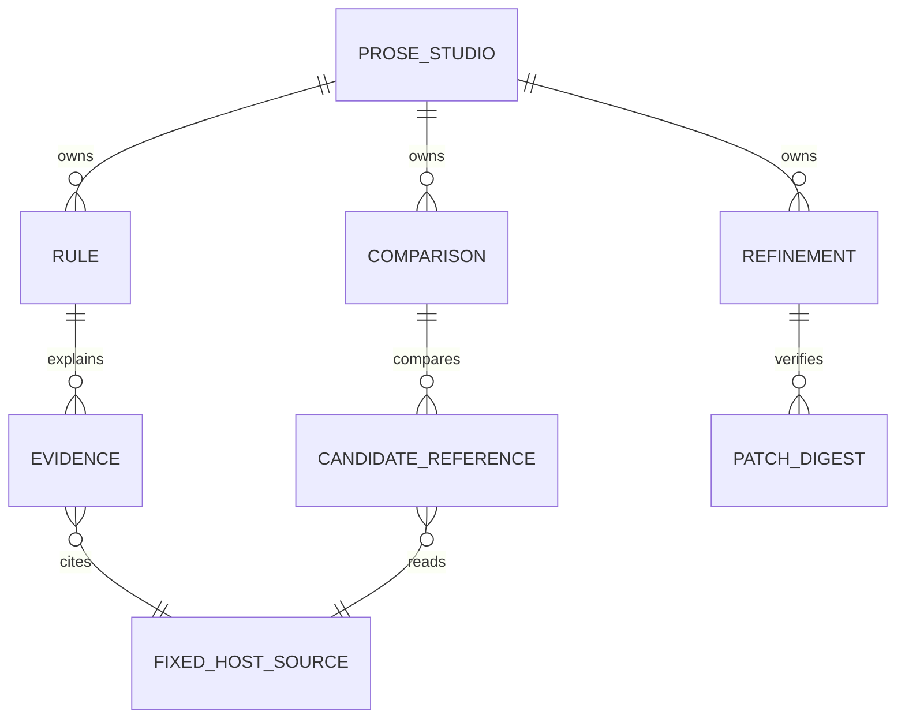

> 本文属于[文风工坊文档](README.md)。

# 数据与 API 设计

实际类型、字段、输入预算及动作效果以 [清单](../contracts/plugin-manifest.json) 为唯一机器合同；构建生成 [操作地图](../skills/hetu-prose-studio/references/operations.md)。

## 1. 专业聚合

插件ID为 `org.wordflowlab.prose-studio`，适用作品为小说，专业类型为 `prose_studio`。根对象包含 `format_version`、`title`、`rules`、`comparisons`、`refinements`；来源位于宿主对象的 `source_refs`，聚合内用 `source_index` 关联，旧索引不可重定向。

| 结构 | 字段与语义 |
| --- | --- |
| Rule | 稳定id、text、scope、origin、status、evidence、conflict_with；origin为author_statement或agent_inference，status为proposed／active／disabled |
| Scope | work／character／chapter及明确target；作品级不填伪造实体，其他范围必须指定目标 |
| Evidence | source_index、byte_start、byte_end、quote；引文必须等于固定来源相应UTF-8字节；任务意见由Agent通过宿主固定任务读取，不复制意见系统 |
| Comparison | 稳定id、title、goal和candidates；每个候选包含id、source_index、strategy、tradeoffs，不持久化全文 |
| Refinement | 稳定id、title、baseline_source_index、candidate_source_index和patches；保存核对所需的字节范围、替换长度与摘要，不保存第二份候选全文 |
| Patch | byte_start、byte_end、replacement_bytes、replacement_sha256；范围按原稿排序，互不重叠，所有边界必须是合法UTF-8边界 |

候选以宿主不可变草稿的证据文稿或已固定文稿引用；正式文稿和未采用候选的身份必须可区分。插件不得通过先采纳来获取候选来源。

## 2. 专业动作

所有动作统一经 `hetu.plugins.invoke` 调用；下表是待实现合同，实际可执行状态只从当前安装版发现。

| 动作 | 效果 | 专业输入／输出 |
| --- | --- | --- |
| list_projects | read | query、limit、cursor；返回分页方案摘要 |
| get_project | read | object_id、可选revision；返回固定对象及sha256 |
| save_project | managed_write | 完整content、source_refs及CAS；新建或更新聚合 |
| put_rule／remove_rule | managed_write | 固定基线及规则或rule_id；保留历史 |
| put_comparison／remove_comparison | managed_write | 固定基线及比较记录或comparison_id |
| preview_refinement | read | 固定原文来源和显式替换；返回候选文本、Patch摘要及验证信息，不落正文 |
| verify_refinement | read | 基线／候选来源及Patch摘要；核对替换内容与范围外原字节 |
| put_refinement | managed_write | 固定基线及精修记录；核对真实来源后保存专业记录 |
| build_context | read | 目标、规则选择、资料选择及字符预算；返回可审阅上下文及裁剪／覆盖说明 |
| get_source | read | object_id、固定revision及source_index；读取已声明来源 |
| compare_versions | read | object_id、from_revision、to_revision；返回专业字段差异 |
| export_project | read | 固定方案及format；返回Markdown或JSON，不写任意路径 |
| get_operation | read | operation_key；返回宿主原操作 |

## 3. 一致性与预算

新建使用 `expected_revision: 0`、`expected_sha256: ""`；更新携带确切对象、修订及摘要。来源只可追加，旧证据不得重定向。Core 拒绝跨作品、错误修订、来源摘要不符、CAS 冲突及同键不同输入。

所有专业写入保留 `operation_key`。调用未知时通过 `get_operation` 先回读，明确不存在才沿原输入执行；不能用新键掩盖未知结果。插件状态不代表作者正文决定。

精修按原稿字节顺序拼接候选：原稿未选片段逐字节复制，替换区单独计算长度和摘要。对现有候选核验时，用每个未变片段及替换字节长度定位，不靠相同词句的模糊匹配；不匹配即拒绝记录成功。

证据、比较候选和精修记录均必须引用当前WorkRef下可核对的固定来源。source_index越界、证据不符、重复专业ID、自相冲突及悬空引用均失败。写作包预算只度量字符与字节；无法容纳必要目标和已选约束时返回缺口，不生成假完整上下文。

## 长篇专业深化

新增能力及兼容合同见[10-专业深度与升级验收](10-专业深度与升级验收.md)。字段以包清单Schema为准，专业动作与Skill由同包生成清单导航，实施及实际验证由08维护。
