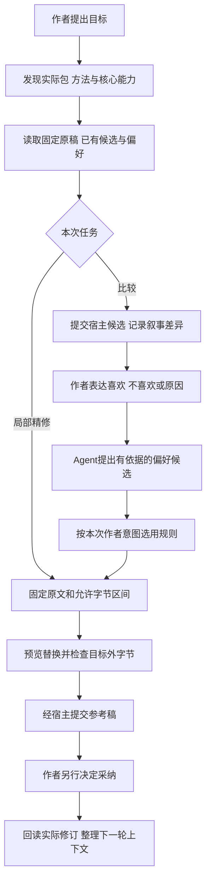

> 本文属于[文风工坊文档](README.md)，定义用例和验收；运行结果只登记08。

# 用户用例与验收

## 1. 创作流程

## 2. 用户与故障矩阵

| 用例 | 输入／触发 | 预期与核验层 |
| --- | --- | --- |
| PSU-01 | 新小说，无规则或反馈 | 可开始比较与精修；不虚构作者偏好。单元＋真实机器 |
| PSU-02 | 对同一场景给出不同写法 | 记录叙事决策与代价；候选固定宿主引用。机器＋GUI |
| PSU-03 | 对候选选段表示喜好 | 保存专业依据关系；可回读原文与当前规则。机器＋GUI |
| PSU-04 | 引文与原文字节不一致 | 拒绝保存假证据。单元＋真实Core |
| PSU-05 | 偏好无证据，由作者直接提出 | 显示作者声明；允许保存，不伪装成从原文提炼。单元＋GUI |
| PSU-06 | Agent推导的规则无依据 | 只能作为待选建议，不能显示为已验证偏好。单元 |
| PSU-07 | 同一人物需要相反写法 | 保留范围与冲突，当前任务显式选择。单元＋机器 |
| PSU-08 | 作者停用或移除规则 | 后续上下文不默认带入；历史修订仍可读。机器＋GUI |
| PSU-09 | 只修改一段中文，原文带CRLF与空格 | 使用UTF-8字节区间；区间外每个字节保持。属性／边界测试 |
| PSU-10 | 区间切进多字节字符、重叠或越界 | 拒绝预览；不“修正”到其他位置。单元 |
| PSU-11 | 候选额外修改未选区域 | 精修核对失败，不写正文。单元＋机器 |
| PSU-12 | 宿主原文出现新修订 | 旧精修仍引用旧版；不能自动套用新原文。机器 |
| PSU-13 | 选择跨作品复用 | 由目标作品重新建立明确规则；没有目标范围时失败，不隐式读其他作品。真实Core |
| PSU-14 | 上下文超过预算 | 返回选材、裁剪与缺少的必要项；不能无提示丢约束。单元＋机器 |
| PSU-15 | CAS冲突 | 返回revision_conflict，保留当前输入及旧基线。机器＋GUI |
| PSU-16 | 同键同输入重发 | 返回相同修订，不新增对象。真实Core |
| PSU-17 | 同键更换规则或引用 | idempotency_conflict。真实Core |
| PSU-18 | 写入已成功，响应丢失 | 先按原键回读成功，不重复执行。故障注入＋机器回读 |
| PSU-19 | 原操作查询unknown | 保持未知，不尝试新写入。单元 |
| PSU-20 | 已有Codex连接中安装／停用／启用 | 发现和Skill随活动包变化，旧包引用失效；客户端工具名保持稳定。MCP |
| PSU-21 | MCP保存、CLI读取及反向写入 | 同作品、同包、同修订、同摘要。真实CLI/MCP |
| PSU-22 | 关闭和重开工作面 | 已存专业状态保持，未保存输入可恢复。Electron |
| PSU-23 | 浅暗、窄窗、长引文、键盘 | 对照、来源和恢复入口可达，无横向溢出或遮挡。Electron＋视觉 |
| PSU-24 | 停用和卸载后查看历史 | 不可新调用；宿主通用读取／导出仍保留成果。机器 |
| PSU-25 | 从第一章推进到下一章 | 回读已用规则与真实成果，只带必要上下文；正文采纳沿宿主独立决定。完整会话 |

## 3. 验收分层

单元测试覆盖UTF-8、证据映射、规则冲突、预算及差异；应用测试覆盖Owner、来源、CAS和未知恢复；集成测试使用真实Core和稳定CLI/MCP，不直接写受管文件。Electron验证真实包及上述同一数据，完整会话验证Skill能引导连续创作。

源码测试、开发宿主、安装版、Mac与Windows分别记录。没有某平台实机时保留未验证，不能由浏览器或Schema通过推导跨平台完成。发布与线上路径验证独立于业务单元测试。

## 长篇专业深化

新增能力及兼容合同见[10-专业深度与升级验收](10-专业深度与升级验收.md)。字段以包清单Schema为准，专业动作与Skill由同包生成清单导航，实施及实际验证由08维护。
