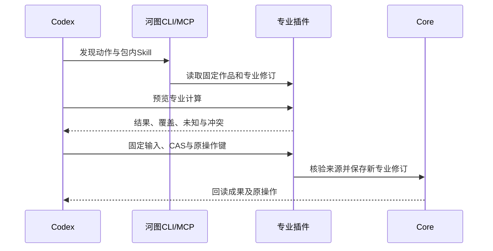

> 本文属于[文风工坊文档](README.md)，定义专业深化合同；实际字段以[03](03-数据与API设计.md)和正式清单为准。

# 专业深度与升级验收

## 1. 问题与目标

“记住我的文风”需要回答：依据哪次修改、适用于谁和什么场景、与哪些偏好冲突、下一次究竟使用了哪些规则。仅保存规则并注入上下文，还不能完成这个目标。

本次静态审计以v0.1.1发布源码为基线，核对`src/domain/model.ts`、`src/application/project.ts`和`src/view/index.tsx`。已具备固定证据、候选比较、选区精修、范围外字节核验和上下文预算。`build_context`未显式选规则时收集全部active规则，尚不按人物或章节匹配；显式选择只验证规则存在，不能据此认定已处理停用状态、作用域或冲突。

本方案补齐作用域选择、修改学习、规则冲突、跨作品模板与选段组合。它不改变既有正文、意见、候选和作者决定的Owner；实施与运行证据只在[08](08-实施计划与验收记录.md)登记。

## 2. 研究依据与采用范围

| 参考 | 采用方法 | 适配要求 |
| --- | --- | --- |
| Novel Craft | 反馈、证据、规则分层；多方向及选段比较 | 作者可只说偏好，由外部Agent准备结构；不固定候选数量 |
| Liltloom | 学习样本资格、规则出处、有界上下文编译 | 只使用明确选择的固定稿与意见，不监听Codex全部会话 |
| dsh-style-memory／Stylome | 可复用风格画像与测量 | 统计、Agent解释与作者偏好分开；不宣称检测AI来源 |
| siweina/dsh-novel-writer | 中文标点、句长等指标 | 启发式口径需版本化；样本不足和中文反例单独验证 |

源码研究范围及固定提交由河图插件29的扩展研究记录维护。本包已采用参考见[09](09-调研依据与设计决策.md)和[来源清单](research-sources.json)。上游说明或代码已读，不等于运行质量通过。

## 3. 领域与数据方案

以下结构通过可选 `depth.version=1` 扩展；实际字段以包清单Schema为准。专业对象仍通过宿主公开SDK保存，不另建数据库或正文副本。

| 结构 | 最小字段与不变量 |
| --- | --- |
| TargetContext | 当前WorkRef、固定章节／候选、涉及人物引用、作者显式选择的文本类型与场景标签；缺失维度保持未知 |
| RuleApplicability | 范围谓词、排除条件和规则版本；人物按引用匹配，名称相同不表示同一人物 |
| LearningSample | 稳定ID、固定原稿与修改稿、合法UTF-8范围、意见依据、来源类型、允许用途；不复制整章 |
| RuleDerivation | 样本引用、提议规则、理由和状态；Agent推导默认为proposed，采用规则不等于采用正文 |
| ConflictResolution | 明确冲突规则ID、适用目标、所选规则或临时例外及理由；不修改其他范围的偏好 |
| CompiledContext | 固定方案、输入摘要、选中／排除／不确定规则及原因、冲突、来源覆盖和预算；输出可复现 |
| StyleTemplate | 导出格式版本、所选规则与来源说明、适用条件；不包含management_ref、密钥或默认整书原文 |
| Composition | 固定候选选段、有序片段引用、连接段及基线；编译结果提交宿主候选，不能直接改正文 |

样本引用和规则引用各自稳定；删除或停用规则不擦除旧任务的使用依据。没有作者改稿理由时，可以形成待确认假设，不能反推唯一偏好。“这次这样写”和“今后都这样写”分别处理。

## 4. 操作与算法

沿用稳定`hetu.plugins.invoke`，不增加Codex插件或独立MCP。正式动作以当前包清单及实际能力发现为准，新增动作见本次实现合同。

| 拟议动作 | 效果与结果 |
| --- | --- |
| `preview_rule_selection` | read；固定方案与TargetContext，返回匹配、排除、不确定及冲突，不落盘 |
| `put_learning_sample` | managed_write；校验原稿、修改稿与意见引用后保存样本 |
| `put_rule_derivation` | managed_write；保存有据提议，不自动将规则设为active |
| `put_conflict_resolution` | managed_write；为固定目标记录显式解决方案 |
| `export_style_template`／`preview_template_import` | read；生成有版本模板、映射预览和损失说明，不跨作品代读正文 |
| `preview_composition` | read；核验片段来源和UTF-8范围，返回组合文本、来源映射与衔接待复核项 |

上下文选择先按状态过滤，再按确切目标匹配，最后检查冲突与预算。窄范围规则只对相应目标生效，不静默覆盖作品级规则；存在显式冲突而未解决时返回未完成选择。目标信息不足返回不确定，不猜人物。作者可为本次显式选择规则，但停用规则需要明确恢复或显式的一次性选择记录，不能默认复活。

字符预算采用统一且有版本的计量口径；必要规则或目标超预算时返回缺口。补充来源被裁剪时说明范围，字符数不等于模型Token数或费用。度量只描述所读文本，不能替代文学判断。

所有写入使用现有CAS及原操作键。模板在目标作品下重新建立专业ID和来源映射，保持出处但不继承另一作品授权。组合稿跨候选拼接后仍需审阅过渡；范围外字节检查相对于明确基线，不能用于证明新连接段符合情节。

## 5. 兼容与实施顺序

现有`format_version=1`及旧动作保持原义。实施前选择新版本聚合或可选扩展，并写明最低包版本和迁移测试；不得静默重写旧对象，也不得让新客户端过滤行为改变历史上下文。旧格式先提供只读选择预览；新增持久化结构再经显式迁移保存，保留旧固定修订。

顺序为：作用域与冲突纯函数及反例 → 公共动作和Schema → 学习样本／模板／组合 → 同包Skill → 作者工作面 → 真实安装包验收。新动作正式实现后才进入CAPABILITIES与生成操作地图。

## 6. 专业用例与门槛

以下为专业验收要求；实际执行结果以08及固定回执为准。

| ID | 输入或反例 | 必须证明 |
| --- | --- | --- |
| PSD-01 | 两个人物、两章及作品级规则 | 不默认互套人物／章节偏好，匹配结果有理由 |
| PSD-02 | 同名人物、未知人物和无场景标签 | 引用不合并，未知不匹配为已知 |
| PSD-03 | 作品级“克制”与本场“情绪外露” | 返回冲突或明确例外；不按最后写入静默覆盖 |
| PSD-04 | 停用规则被显式选中、删除规则仍被旧样本引用 | 不默认启用；旧上下文和证据仍可解释 |
| PSD-05 | 原稿与修改稿无说明、有说明、相反说明 | 分别保留假设与作者声明，不自动提炼唯一口味 |
| PSD-06 | 一次性人物试写与长期偏好 | 本次选择不扩展为所有人物或全部作品 |
| PSD-07 | 仅向目标作品提供模板 | 无原作品授权仍可导入所选规则，不能回读受限原文 |
| PSD-08 | 模板未知字段或范围无法映射 | 给出损失和待映射项，不能假称无损 |
| PSD-09 | 中文、emoji、CRLF和混合换行的候选片段 | 来源及范围准确；明确基线外字节保持 |
| PSD-10 | A动作＋B对白，存在时间或人称断裂 | 返回固定组合候选和衔接待审项，不自动采纳 |
| PSD-11 | 必要规则超预算、补充资料被裁剪 | 缺口可见，不产生假完整上下文或假Token费用 |
| PSD-12 | 并发改规则、响应丢失、升级与停用 | CAS保留输入，原键回读；历史规则与旧候选可读 |

单元验证选择、冲突和字节不变量；真实CLI/MCP验证固定来源、旧格式、CAS及恢复；同一Codex会话验证发现和Skill引导；正式包作者工作面验证来源、选择结果、冲突和差异可读。生成质量与作者偏好另行审阅，自动化通过不代替作者认可。

## 本次实现合同

目标版本 `0.2.0`。范围为作用域与冲突、学习样本与提议、模板映射、固定片段组合。聚合保留原 `format_version=1`，新增可选 `depth.version=1`；旧对象读取、旧动作和历史修订原义保持。仅 `save_depth` 或新的逐项写动作显式建立深化结构；读取不自动迁移，保存通过宿主CAS产生新修订。旧客户端必须拒绝未知字段，不得裁掉深化结构后覆盖。

实际字段以包清单 Schema 为唯一来源。新动作均通过原有稳定 CLI/MCP 转发；纯 TypeScript 计算专业结果，React/SVG 展示，ProjectStore 负责固定来源与原键恢复，Core 拥有作品和决定。

| 动作 | 用途 | 效果 |
| --- | --- | --- |
| `preview_rule_selection` | 按本次目标选择偏好 | read |
| `compile_context` | 编译有作用域的接续上下文 | read |
| `put_learning_sample` | 保存固定修改样本 | managed_write |
| `put_rule_derivation` | 保存有据偏好提议 | managed_write |
| `put_conflict_resolution` | 保存本次偏好冲突决定 | managed_write |
| `put_rule_applicability` | 保存规则适用条件 | managed_write |
| `export_style_template` | 导出所选风格模板 | read |
| `preview_template_import` | 预览风格模板映射 | read |
| `preview_composition` | 组合固定候选片段 | read |
| `save_depth` | 保存明确专业深化结构 | managed_write |

测试分别覆盖纯算法反例、闭合Schema、非法来源、旧格式、CAS、丢失响应、真实CLI/MCP和实际工作面。实现与发行证据只在08维护；此处不以方案代替验收。

同作品跨插件依据使用可选 `depth.basis_refs`，每项固定Owner、对象、修订与摘要；保存和 `inspect_basis` 经公开Core读取核验。不把专业引用塞进正文来源索引，不导入其他插件内部模块；旧依据不随上游更新。没有另一作品连接时不能跨作品读取。
